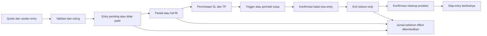

# Inti eksekusi Binance — Rust

Komponen awal mesin trading: sizing, siklus order/posisi, TP/SL, batas risiko,
dan jurnal persisten. **Hanya simulasi lokal**, belum tersambung ke akun atau
strategi. Binary tidak punya klien jaringan, pembaca kredensial, ataupun mode live.

## Jalankan

```bash
cd ~/Workspace/projects/binance-sniper/engine-rs
source ~/.cargo/env
cargo build --locked --release

# Folder keluaran harus baru; direktori induknya sudah tersedia.
target/release/binance-engine demo \
  --output ~/Workspace/outputs/binance-engine-demo-baru

target/release/binance-engine status \
  --journal ~/Workspace/outputs/binance-engine-demo-baru/journal.jsonl

# Pipeline toolchain proyek yang sudah terpasang.
rust-workbench check
```

Demo menghasilkan `report.md`, `report.json`, `config.json`, `events.jsonl`,
`effects.json`, dan `journal.jsonl`. Simbol `SYNTHUSDT`, modal 1000, biaya,
batas risiko, harga, dan fill merupakan **fixture pengujian**. Bukan pengaturan
akun pengguna, saran alokasi, backtest, atau bukti profit.

Sesi sendiri memakai konfigurasi eksplisit dan event JSONL:

```bash
target/release/binance-engine validate-config --config fixtures/paper.json
target/release/binance-engine init --config fixtures/paper.json --journal run.jsonl
target/release/binance-engine apply --journal run.jsonl --events events.jsonl
target/release/binance-engine status --journal run.jsonl
```

Gunakan `events.jsonl` hasil demo sebagai contoh format. Semua nilai uang,
harga dan kuantitas harus berupa **string desimal**, misalnya `"0.001"`.
Waktu memakai milidetik UTC dari caller; tidak mengambil waktu sistem diam-diam.
`apply` berhenti pada penolakan pertama dan menyimpan penolakan tersebut ke jurnal.
File masukan maksimal 2 MiB; batch maksimal 10.000 event.

## Alur dan kontrak



- Satu simbol, satu posisi, long atau short; acuan kontrak linear USDⓈ-M one-way.
  Pilihan pasar final pengguna belum ditetapkan. Tidak ada model leverage;
  notional dibatasi modal simulasi.
- `Enter` hanya usulan. `Effect::PlaceEntry`, `PlaceProtection`, `PlaceExit`,
  `CancelEntry`, `CancelProtections`, dan `QueryOrder` adalah **instruksi keluar**.
  Tidak membuktikan order dikirim, diterima, atau terisi. Fixture memasok laporan
  broker tiruan secara terpisah.
- `side: long/short` pada effect menyatakan aksi buy/sell. Proteksi memakai
  close-all; exit memakai reduce-only. Proteksi pertama diminta segera setelah
  fill positif, dan status `Active` hanya muncul setelah laporan penerimaan.
- Partial fill memakai jumlah, nilai transaksi, dan fee **kumulatif per order**.
  Fee diasumsikan sudah dinormalisasi ke USDT, nonnegatif; rebates/komisi aset
  lain perlu adapter. P&L memakai harga masuk rata-rata tertimbang dan fee aktual
  pada laporan, serta bid untuk mark long dan ask untuk mark short.
- Timeout/hasil kirim tidak pasti mengeluarkan query, tanpa mengulang entry/exit.
  Laporan berikutnya harus `reconciled: true`. Flag ini merupakan kontrak dengan
  caller yang dipercaya; v1 belum memverifikasi hasil exchange sendiri.
- Sebelum exit, sisa entry harus terminal (filled/canceled/rejected/expired).
  Fill tambahan sebelum konfirmasi batal masuk ke ukuran exit. Cleanup harus
  dikonfirmasi sebelum trade lain. ID intent tidak boleh dipakai ulang.
- Penolakan proteksi, timeout proteksi, data usang saat ada kemungkinan eksposur,
  fill entry melewati asumsi, atau batas loss melatch penghentian entry baru.
  Bila masih ada eksposur, mesin meminta penutupan melalui alur di atas.
- Bila exit berakhir dengan posisi tersisa, status tetap terbuka dan dihentikan.
  **Belum ada retry exit/recovery otomatis** untuk kasus ini.

## Penjaga risiko

- Kuantitas dibulatkan turun menurut min-qty/step, lalu diperiksa terhadap
  maksimum kuantitas, min-notional, budget risiko dan batas notional.
- Budget transaksi memasukkan jarak ke stop, asumsi slippage entry/exit dan fee
  dua sisi. Stop/TP harus sesuai grid harga serta sisi arah yang masuk akal.
- Quote ditolak bila crossed, usang, future-dated, mundur, atau spread berlebih.
  Angka input dibatasi magnitudo 10¹² dan 12 tempat desimal; aritmetika inti checked.
- Batas total diukur dari modal awal. Batas harian memakai equity tersimpan
  terakhir sebelum event pertama di hari UTC berikutnya; gap ikut dihitung.
  Equity memasukkan P&L terealisasi, fee yang sudah dilaporkan dan mark posisi.
  Waktu pencatatan fee adalah waktu laporan, bukan rekonstruksi tanggal trade.
- Batas loss merupakan ambang penghentian/permintaan exit, **bukan jaminan rugi
  maksimal**. Gap, keterlambatan, slippage dan penolakan exit dapat melampauinya.
  Halt tetap tersimpan setelah restart/pergantian hari; tidak ada tombol resume v1.

## Persistensi dan integrasi

`Journal` adalah API aplikasi yang disarankan. `Engine` merupakan state machine
di memori untuk pengujian; ia sendiri tidak menyediakan deduplikasi event-id.

Jurnal JSONL berurutan memakai SHA-256 per record, hash state hasil replay,
`sync_all` sebelum commit memori/effect dikembalikan, serta lock file eksklusif.
Retry ID dan isi event yang sama tidak menambah record atau mengeluarkan effect
lagi. ID sama dengan isi berbeda ditolak. Replay memeriksa versi skema, rantai
hash, outcome dan state; perubahan semantik memerlukan migrasi eksplisit.

Jurnal kosong/terpotong/berubah ditolak; tidak otomatis dipangkas. Maksimal
16 MiB, 20.000 record, 64 KiB per record. Rollover, pemulihan tail, dan migrasi
belum tersedia. Checksum bukan tanda tangan atau perlindungan terhadap pemilik
filesystem yang sengaja menulis ulang seluruh riwayat. Status juga mengambil
lock; tutup writer sebelum memanggil CLI status dari proses lain.

Caller wajib:

1. Mengirim quote/laporan yang dinormalisasi serta `Tick` berkala dengan waktu
   monoton. CLI bukan daemon; tanpa event/tick tidak ada pemeriksaan timer.
2. Berhenti dan merekonsiliasi jika event ditolak. Penolakan tidak mengubah state
   sebelumnya, termasuk quote; jangan melanjutkan trading dengan mengabaikan error.
3. Pada restart, merekonsiliasi **seluruh** order/proteksi/posisi sebelum tindakan
   baru. Crash setelah persist tetapi sebelum dispatch tidak berarti order belum
   dikirim. `Pending` harus diperiksa lewat ID stabil, bukan langsung dikirim ulang.
4. Menangani event Binance terlambat/out-of-order, protection fill, cancel race,
   perbedaan snapshot dan komisi sebelum memetakannya ke schema ini. V1 menolak
   perubahan pada order terminal; belum menangani koreksi fill exchange.

## Yang belum dibangun

Adapter REST/WebSocket dan signing Binance, outbox dispatcher, startup/account
reconciliation nyata, protective-order execution/cancel race nyata, koneksi
ke observer/strategi existing, pengambilan filter aktual, funding, margin,
likuidasi, order book, hedge mode, multi-posisi, pelayanan daemon dan UI kontrol.
TP/SL v1 dipicu oleh quote lokal; laporan fill exit disediakan simulator.
Tidak ada klaim parity protokol Binance atau simulasi likuiditas yang realistis.

Strategi lama yang gagal tetap berstatus gagal. Putaran ini tidak melakukan
pencarian strategi atau backtest baru. Adapter berikutnya perlu memetakan order
biasa dan conditional sesuai dokumentasi Binance yang berlaku; acuan saat
implementasi adalah [trade API](https://developers.binance.com/en/docs/catalog/core-trading-derivatives-trading-usd-s-m-futures/api/rest-api/trade)
dan [filter instrumen](https://developers.binance.com/en/docs/products/derivatives-trading-usds-futures/common-definition).

## Struktur dan verifikasi

| File | Peran |
|---|---|
| `src/model.rs` | Kontrak konfigurasi, event, state, effect |
| `src/risk.rs` | Validasi desimal, quote, filter dan sizing |
| `src/engine.rs` | Siklus order/posisi, fee/P&L, TP/SL dan penghentian |
| `src/journal.rs` | Persistensi, deduplikasi, lock dan replay |
| `src/main.rs` | CLI dan demo sintetis yang dapat direproduksi |
| `tests/` | Uji perilaku eksekusi, risiko, persistensi dan proses CLI |

Rust 1.98.1; dependency langsung terpin di `Cargo.toml`, dependency transitif
terkunci di `Cargo.lock`. Tidak perlu dependency Python atau pemasangan sistem.
Protokol dan keputusan putaran: [EXECUTION_ROUND_01.md](../docs/EXECUTION_ROUND_01.md).
